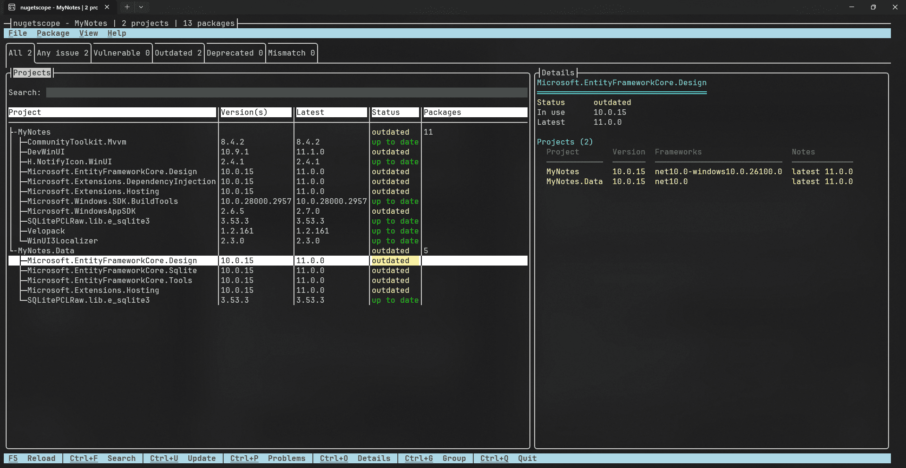
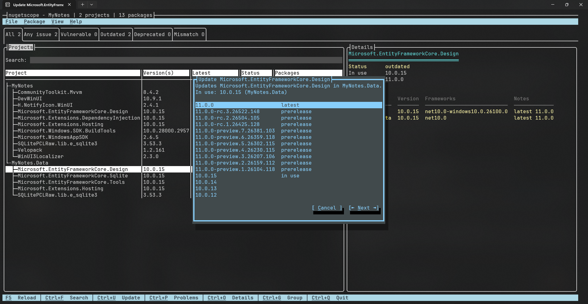

# nugetscope

An interactive, keyboard-driven terminal dashboard for the NuGet packages in a whole .NET solution.

Point it at a `.sln` or `.slnx` and it shows every package used by every project: which are **outdated**, **vulnerable**, **deprecated**, or used at **mismatched versions** across projects. You can update them from the same screen, and it shows exactly which files will change before writing anything. It also runs headless in CI, printing a JSON or text report and returning a meaningful exit code.

`dotnet list package` and `dotnet-outdated` print per-project text dumps. nugetscope gives you one solution-wide view that you can browse, filter and act on, and it works over SSH.



## Features

- **Solution-wide view.** Every package across all projects, grouped by project (the default) or by package.
- **Status tabs.** All, Any issue, Vulnerable, Outdated, Deprecated, Mismatch and Possibly unused, each with a count and its own search.
- **Possibly unused packages.** A best-effort hint for direct references that no code in the project appears to use.
- **Details pane.** Versions per project, vulnerability severities with advisory links, deprecation reasons and suggested alternatives, and a version-mismatch table showing which projects are behind.
- **Honest statuses.** If a check couldn't run (for example, a feed was unreachable), the status shows `?` instead of claiming "up to date".
- **Safe updates.** Pick a version, review the exact file edits, then confirm. Works with Central Package Management (`Directory.Packages.props`) and `VersionOverride`.
- **Transitive packages.** Toggle them on to see, for example, vulnerable packages pulled in indirectly.
- **Restore problems surfaced.** Projects that fail to restore show their errors instead of silently missing from the list.
- **CI mode.** `--json`, `--markdown` and `--fail-on` for pipelines.
- **Markdown export.** Save the results as a report to share, from the dashboard (`Ctrl+S`) or the command line.

## Requirements

- .NET 10 SDK (nugetscope calls the `dotnet` CLI for all package data).
- A terminal. Windows Terminal, any modern Linux/macOS terminal, and SSH sessions all work.

## Install

nugetscope is a `dotnet tool`:

```sh
dotnet tool install -g nugetscope   # then run: nugetscope
dotnet tool update -g nugetscope
dnx nugetscope                      # or run once without installing (.NET 10 SDK)
```

To install from source instead:

```sh
git clone https://github.com/Erencrypt/nugetscope.git
cd nugetscope
dotnet pack NugetScope.Tui -c Release -o out
dotnet tool install -g nugetscope --add-source ./out
```

To run without installing:

```sh
dotnet run --project NugetScope.Tui -- path/to/YourSolution.slnx
```

## Usage

```sh
nugetscope                      # look for a solution in the current directory (asks if there are several)
nugetscope YourSolution.slnx    # open a specific solution
nugetscope path/to/repo         # look for a solution in a directory
```

The first scan runs `dotnet restore`, then lists packages and checks the feeds for updates, deprecations and vulnerabilities. The window title shows progress.

### Keys

| Key                | Action                                           |
| ------------------ | ------------------------------------------------ |
| `Enter` / `Ctrl+U` | Update the selected package                      |
| `F5`               | Reload (restore and scan again)                  |
| `Ctrl+F`           | Search the current tab (package or project name) |
| `Ctrl+P`           | Show restore and scan problems                   |
| `Ctrl+O`           | Focus the details pane, or go back to the list   |
| `Ctrl+G`           | Group by project / by package                    |
| `Ctrl+T`           | Show or hide transitive packages                 |
| `Ctrl+S`           | Export a Markdown report                         |
| `F3`               | Next tab                                         |
| `F1`               | Help: keys and what each status means            |
| `F10`              | Open the menu                                    |
| `Ctrl+Q`           | Quit                                             |

Navigation follows Terminal.Gui conventions: `↑`/`↓` move through the list (and between it and the search box), `←`/`→` collapse or expand a project and switch tabs on a tab header, and `F6`/`Shift+F6` move between the list and the details.

### Statuses

| Status          | Meaning                                                                    |
| --------------- | -------------------------------------------------------------------------- |
| vulnerable      | The version in use has a known security advisory                           |
| deprecated      | The author marked the package deprecated                                   |
| outdated        | A newer version is available                                               |
| mismatch        | Projects use different versions of the package                             |
| possibly unused | No code in the project appears to use it (a hint, not an issue; see below) |
| up to date      | None of the above, and every check ran                                     |
| `?`             | A check couldn't run, so the status is unknown (`Ctrl+P` shows why)        |

### Possibly unused packages

After each scan, nugetscope checks in the background whether each direct package reference is used. The dashboard stays usable meanwhile, and the title shows progress. A reference is flagged when none of the namespaces in the package's compile assemblies appear anywhere in the project:

- source files (C#, F#, VB) and global usings/imports,
- Razor and MVC views, XAML (WPF, WinUI, MAUI, Avalonia) and Web Forms pages,
- `web.config`/`app.config` and `appsettings*.json`.

It's a hint, never a verdict. Use through reflection, DI assembly scanning or configuration that names only a type or assembly, never a namespace, can't be seen this way. So it isn't counted as an issue, it can't be used with `--fail-on`, and nugetscope never removes anything. To keep false alarms down, these references are never flagged:

- packages with nothing to compile against (analyzers, meta-packages, test adapters),
- packages that hook into the build with their own props/targets,
- development-only references (`PrivateAssets="all"`) or references that exclude compile assets.

If a project can't be checked (for example, it hasn't been restored), the reason shows in its details and under `Ctrl+P`.

## Updating packages

Select a package and press `Enter`. In by-project grouping, a package row under a project updates just that project; in by-package grouping it updates every project that uses the package.

1. **Pick a version.** The list comes from your configured package sources (`nuget.config` is honoured), newest first, with the latest and in-use versions marked.
2. **Review the plan.** nugetscope evaluates each project with MSBuild to find where the version is actually declared:
   - the project file (`<PackageReference Version="...">`),
   - a `VersionOverride`, or
   - a central `<PackageVersion>` in `Directory.Packages.props`. The plan then lists every project that shares it, including ones you didn't select.

   The confirmation dialog lists each file, the old and new version, and the affected projects.
3. **Confirm.** Cancel is the default button, so pressing `Enter` alone never writes anything.



Only the version text is replaced. Formatting, comments, encoding (including a BOM) and line endings stay exactly as they were. If any file changed after the preview, nothing is written. After a successful update, nugetscope restores and rescans.

Some versions are left alone, with the reason shown in the plan:

- versions set through an MSBuild property (`Version="$(MyVersion)"`); change the property yourself,
- packages declared several times in one file (for example under different conditions),
- packages that are only transitive; add a direct reference first.

## CI mode

Any of these options runs nugetscope without the dashboard:

| Option                 | Effect                                                                                                                                    |
| ---------------------- | ----------------------------------------------------------------------------------------------------------------------------------------- |
| `--json`               | Print a JSON report to stdout                                                                                                             |
| `--markdown`           | Print a Markdown report to stdout (for example, for a job summary or a pull request comment)                                              |
| `--fail-on <statuses>` | Exit with code 2 if any package has one of these statuses: `vulnerable`, `deprecated`, `outdated`, `mismatch` (comma-separated), or `any` |
| `--transitive`         | Include transitive packages (slower; they are checked too)                                                                                |
| `-h`, `--help`         | Show usage                                                                                                                                |

Exit codes:

| Code | Meaning                                                                                  |
| ---- | ---------------------------------------------------------------------------------------- |
| `0`  | Success (and nothing matched `--fail-on`)                                                |
| `1`  | Error: bad arguments, no solution found, scan failed, or incomplete data for `--fail-on` |
| `2`  | A package matched `--fail-on`                                                            |

With `--fail-on`, missing data never counts as a pass. If a check the gate depends on didn't complete (for example, a feed was unreachable), or a project couldn't be restored, the run exits with `1`. `mismatch` needs no feed access.

```sh
# Fail the build on vulnerable or deprecated packages, with a readable log
nugetscope YourSolution.slnx --fail-on vulnerable,deprecated

# Machine-readable report (stdout stays pure JSON; the --fail-on result goes to stderr)
nugetscope YourSolution.slnx --json --fail-on vulnerable > nugetscope-report.json
```

Example GitHub Actions steps (the runner needs the .NET 10 SDK):

```yaml
- name: Install nugetscope
  run: dotnet tool install -g nugetscope
- name: Check NuGet packages
  run: nugetscope YourSolution.slnx --fail-on vulnerable --transitive
```

The JSON report (format `version: 1`) looks like this:

```json
{
  "version": 1,
  "solution": "/repo/YourSolution.slnx",
  "completedChecks": ["vulnerable", "deprecated", "outdated"],
  "summary": { "projects": 3, "packages": 12, "vulnerable": 1, "deprecated": 0, "outdated": 4, "mismatch": 1, "possiblyUnused": 2 },
  "packages": [
    {
      "id": "Some.Package",
      "status": ["vulnerable", "outdated"],
      "versions": ["1.2.0"],
      "latest": "1.4.1",
      "transitive": false,
      "vulnerabilities": [{ "severity": "high", "advisoryUrl": "https://github.com/advisories/..." }],
      "projects": [{ "project": "Api", "frameworks": ["net10.0"], "requested": "1.2.0", "resolved": "1.2.0", "latest": "1.4.1", "transitive": false }]
    }
  ],
  "projects": [{ "name": "Api", "path": "/repo/src/Api/Api.csproj", "problems": [] }],
  "problems": []
}
```

## How it works

nugetscope relies on the official tools rather than reimplementing NuGet:

- the solution is read with `Microsoft.VisualStudio.SolutionPersistence` (both `.sln` and `.slnx`),
- package data comes from `dotnet restore` followed by `dotnet list package --format json` (base list, `--outdated`, `--deprecated`, `--vulnerable`, run in parallel),
- update targets come from `dotnet msbuild -getItem`, and versions from `dotnet package search`.

The UI is built with [Terminal.Gui](https://github.com/tui-cs/Terminal.Gui) v2.

For the details of how updates find and edit versions, and how the possibly-unused check decides, see [docs/how-it-works.md](https://github.com/Erencrypt/nugetscope/blob/main/docs/how-it-works.md).

## Building and testing

```sh
dotnet build
dotnet test
```

Tests use xunit.v3 on Microsoft.Testing.Platform with captured CLI output, so they need no network or real `dotnet` calls.

## License

[GPL-3.0](https://github.com/Erencrypt/nugetscope/blob/main/LICENSE)
